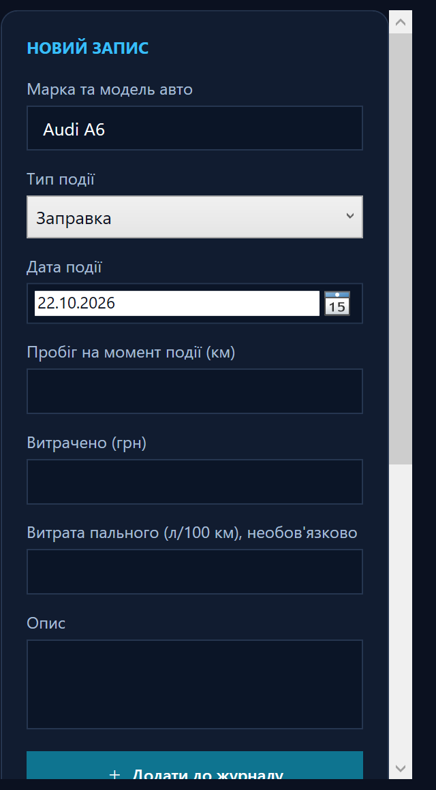

# Звіт про розробку програми AutoHub Pro

## Тема та мета

**AutoHub Pro** — настільна програма для ведення автомобільного журналу. Мета проєкту — надати простий спосіб фіксувати витрати та обслуговування автомобіля, знаходити записи й оцінювати вартість поїздки.

## Функціональність

- створення та редагування записів про заправки, техобслуговування, ремонт та інші події;
- фіксація моделі автомобіля, дати події, пробігу, витрат, витрати пального й опису;
- пошук записів і сортування таблиці за стовпцями;
- фільтр за типом події та окреме сортування за датою, пробігом і сумою витрат;
- видалення запису з підтвердженням;
- автозбереження та імпорт/експорт даних у форматі JSON;
- відображення кількості записів, витрат за поточний місяць і середньої витрати пального;
- стовпчикова діаграма сумарних витрат за кожен з останніх шести місяців;
- нагадування про наступне техобслуговування за заданим пробігом, включно з позначенням наближення чи прострочення;
- розрахунок необхідного пального та орієнтовної вартості поїздки;
- перевірка введених даних і повідомлення про помилки роботи з файлами.

## Інтерфейс та технології

Застосунок створено мовою C# для Windows із використанням WPF та .NET 9. Темна панель приладів, сині акценти й окремий калькулятор поїздки відповідають автомобільній тематиці. Користувач задає дату події, тож може внести попередню історію та побачити її у шестимісячній діаграмі. Для кожного запису ТО можна вказати плановий пробіг наступного обслуговування; програма порівнює його з останнім зафіксованим пробігом відповідного авто й відображає нагадування. Дані зберігаються локально у JSON; додатково доступні імпорт та експорт резервної копії.

## Фото програми

Нижче наведено фрагмент реального вікна програми з формою автомобільного запису.

## Інструкція користувача

1. Введіть дані про автомобільну подію та натисніть **Додати до журналу**.
2. Для редагування двічі натисніть рядок; внесіть зміни та натисніть **Зберегти зміни**.
3. Для видалення виберіть рядок, натисніть **Видалити** й підтвердіть дію.
4. Знайдіть потрібне за допомогою пошуку, відфільтруйте за типом події або виберіть сортування за датою, пробігом чи витратами.
5. Додайте плановий пробіг у записі ТО, щоб бачити нагадування про майбутнє обслуговування.
6. Діаграма показує витрати по місяцях за останнє півріччя; наведіть курсор на стовпчик, щоб побачити деталі.
7. Для оцінки поїздки введіть відстань, витрату пального та ціну літра в калькуляторі.
8. Використовуйте імпорт та експорт JSON для перенесення або резервного копіювання журналу.

Детальні кроки запуску й використання подані у [короткій інструкції](./README.md).

## Перевірка та демонстрація

Проєкт перевіряється командою `dotnet build AutoHubPro.csproj`. Під час демонстрації рекомендовано показати:

1. головне вікно та форму створення запису;
2. таблицю з кількома записами й підсумки місяця;
3. шестимісячну діаграму витрат і підказку з сумою за місяць;
4. фільтр за типом події та сортування за датою;
5. нагадування про планове ТО;
6. редагування запису;
7. розрахунок вартості поїздки;
8. експорт та імпорт JSON-файлу.

**Фото/відео до звіту:** додайте власні знімки екрана або відеозапис фактичного запуску програми після її відкриття у Windows. У вихідних матеріалах не підмінюйте реальні результати макетами.

## Склад проєкту

- `MainWindow.xaml` — інтерфейс програми;
- `MainWindow.xaml.cs` — логіка журналу, перевірка даних, пошук, підсумки, калькулятор та робота з JSON;
- `App.xaml` і `App.xaml.cs` — запуск WPF-застосунку;
- `AutoHubPro.csproj` — конфігурація проєкту;
- `README.md` — коротка інструкція користувача.
